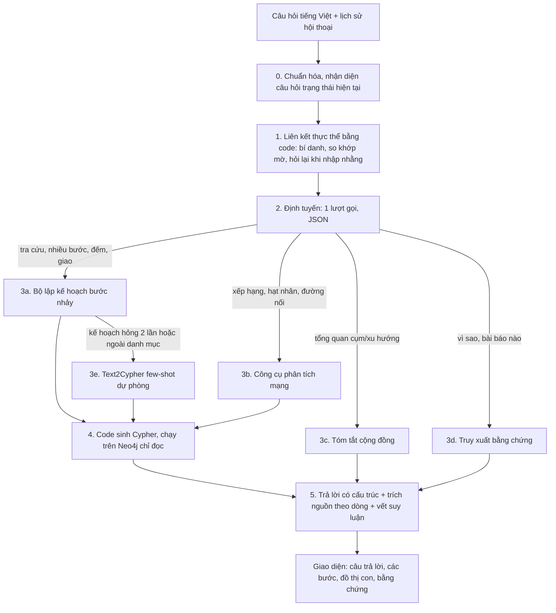

# Thiết kế hoàn chỉnh chatbot GraphRAG multi-hop (Qwen3-4B, Kaggle → máy)

Tài liệu này tổng hợp các hướng làm chatbot hỏi đáp trên đồ thị, bài học từ nhóm trước và kết quả thực nghiệm của nhóm, rồi chọn ra **một luồng hoàn chỉnh**: từ phục vụ mô hình trên Kaggle, gọi về máy, đến cách mô hình làm việc để trả lời chính xác nhất. Thay cho `THIET_KE_CHATBOT_KAGGLE.md` ở phần pipeline; phần hạ tầng Kaggle vẫn dùng lại.

## 1. Ràng buộc

| Ràng buộc | Hệ quả thiết kế |
|---|---|
| Mô hình ≤ 9B (đề bài) | Qwen3-4B cho mọi bước có LLM; mô hình lớn (Gemini qua 9Router) chỉ để sinh dữ liệu phụ trợ và làm mốc so sánh |
| Câu hỏi tiếng Việt, tên riêng tiếng Anh, nhiều biệt danh | Liên kết thực thể phải làm bằng code, không để mô hình đoán tên |
| Đề yêu cầu multi-hop và yếu tố phân tích mạng | Phải có suy luận nhiều bước minh bạch và công cụ PageRank/cộng đồng/hạt nhân |
| Graph lưu quan hệ lịch sử, có câu bằng chứng | Câu trả lời phải trích nguồn; không khẳng định tình trạng hiện tại |
| GPU T4 x2 trên Kaggle, phiên tối đa 12 giờ, gọi qua tunnel | Ít lượt gọi LLM mỗi câu hỏi; có phương án dự phòng khi Kaggle không chạy |

## 2. Các hướng đã khảo sát

| Hướng | Cách làm | Ưu | Nhược | Bằng chứng của nhóm |
|---|---|---|---|---|
| A. Hỏi thẳng mô hình | LLM trả lời từ trí nhớ | Đơn giản | Bịa, không dùng graph, không đạt GraphRAG | Loại |
| B. RAG vector trên văn bản | Nhúng câu bằng chứng/bài báo, tìm tương tự | Tốt cho câu "vì sao, bối cảnh" | Kém với nhiều bước, đếm, giao | Chưa làm; dùng cho nhánh bằng chứng |
| C. Text2Cypher tự do | Mô hình viết Cypher, có kiểm tra và sửa lỗi | Linh hoạt nhất | Mô hình nhỏ hay sai cú pháp, sai chiều | Few-shot 12/24, thêm thinking 14/24; câu nhiều bước chỉ 2/6 |
| D. Mẫu truy vấn cố định | Mô hình chọn 1 trong N mẫu Cypher | Chạy nhanh, luôn hợp lệ | Chỉ trả lời được dạng đã có, không nối bước | 10/24 với 20 mẫu |
| **E. Lập kế hoạch theo bước nhảy** | Mô hình chọn chuỗi bước nhảy có tên; code kiểm tra kiểu và sinh Cypher | Không gian đầu ra nhỏ, Cypher luôn đúng, multi-hop minh bạch | Câu hỏi ngoài danh mục bước nhảy không trả lời được | Danh mục phủ 32/32 câu benchmark; lượt chạy đầu với Qwen3-4B đúng 9/9 câu dev đầu tiên (đang chạy đủ) |
| F. Agent lặp (ReAct, Think-on-Graph) | Mô hình gọi công cụ nhiều vòng, xem kết quả trung gian | Hợp câu hỏi thăm dò | Nhiều lượt gọi, chậm, mô hình nhỏ dễ lạc khi vòng dài | Chỉ dùng cho câu phân tích |
| G. GraphRAG kiểu Microsoft | Tóm tắt từng cộng đồng trước, trả lời câu tổng quan từ các tóm tắt | Trả lời được "cụm này có đặc điểm gì" | Cần sinh tóm tắt trước, khó kiểm chứng | Đã có 13 cộng đồng Leiden; làm nhánh tổng quan |
| H. Công cụ phân tích xác định | Mô hình chọn hàm, code tính (PageRank...) | Số liệu chính xác | Chỉ trong phạm vi hàm có sẵn | 3/3 bài thử chọn đúng |
| I. Fine-tune | Huấn luyện thêm cho Text2Cypher hoặc cho bộ lập kế hoạch | Tăng độ chính xác | Tốn dữ liệu và GPU, dễ rò rỉ dữ liệu khi đánh giá | Nhóm trước làm Text2Cypher |

### Bài học từ nhóm trước (Nhóm 13, đồ thị Nobel)

- **Làm tốt:** sinh dữ liệu ngược (Cypher theo số bước, rồi Gemini viết câu hỏi), kiểm soát tỷ lệ 1–4 bước, so với một mô hình lớn làm mốc.
- **Hạn chế:** dùng Qwen3-0.6B (rất nhỏ); bộ đánh giá trắc nghiệm được lấy từ chính dữ liệu fine-tune, chỉ đổi cách diễn đạt (rò rỉ); trắc nghiệm dễ hơn trả lời tự do; không đo tỷ lệ Cypher chạy đúng; câu 3 bước chỉ 58,8%.
- **Rút ra cho nhóm:** giữ ý sinh dữ liệu ngược và chia theo số bước; **đánh giá bằng so khớp kết quả truy vấn trên graph** thay cho trắc nghiệm; tách tập kiểm tra theo thực thể và theo mẫu câu; thu hẹp không gian đầu ra của mô hình (hướng E) thay vì bắt mô hình nhỏ viết Cypher dài.

## 3. Luồng chọn

### 3.1. Liên kết thực thể (code, không dùng LLM)

- Khớp `canonical_name` và `aliases` trong Neo4j như hiện tại; thêm **so khớp mờ** (RapidFuzz) cho lỗi gõ và tên không dấu, và **từ điển biệt danh tiếng Việt** ("Quỷ đỏ", "Pháo thủ", "Bầy cáo"...).
- Chỉ có họ ("Henderson") mà nhiều người trùng: trả lại danh sách để người dùng chọn (giao diện hiện nút chọn), không tự đoán.
- **Hội thoại nhiều lượt:** nhớ thực thể của câu trước để hiểu "còn HLV của anh ấy thì sao?".
- Đo riêng độ chính xác liên kết, vì benchmark hiện cấp sẵn tên chuẩn.

### 3.2. Định tuyến

Một lượt gọi không bật thinking, JSON có schema: `{"route": "graph_path|analytics|community|evidence|out_of_scope"}`. Có luật dự phòng bằng từ khóa (ví dụ "PageRank", "hạt nhân", "vì sao", "bài báo") để không phụ thuộc hoàn toàn vào mô hình.

### 3.3. Bộ lập kế hoạch bước nhảy (nhánh chính)

Đã có trong `src/player_graph/chatbot/agent.py`. Các cải tiến theo thứ tự hiệu quả trên chi phí:

1. **Ràng buộc đầu ra bằng JSON schema** (vLLM structured output, tài liệu HANDOFF của nhóm đã dùng thành công): khai báo `hops` là `enum` gồm đúng tên các bước nhảy và `from` là `enum` các tham số có trong câu. Mô hình **không thể** sinh tên bước sai hay JSON hỏng; vòng sửa lỗi chỉ còn lo lỗi kiểu.
2. **Ví dụ few-shot chọn động:** thư viện khoảng 60 ví dụ phủ mọi bước nhảy; mỗi câu chọn 6–8 ví dụ gần nhất (theo từ khóa hoặc embedding nhỏ chạy trên CPU).
3. **Self-consistency:** sinh 3 kế hoạch (nhiệt độ 0,6, không thinking, khoảng 1 giây mỗi lượt), biên dịch, chọn kế hoạch được nhiều phiếu nhất. Rẻ hơn thinking mà thường tăng độ ổn định với mô hình nhỏ.
4. **Thinking thích ứng:** chỉ bật khi kế hoạch không thinking hỏng kiểm tra hoặc các phiếu không thống nhất, thay vì bật cho mọi câu nhiều bước.
5. **Mở rộng danh mục khi gặp câu ngoài phạm vi:** ví dụ thêm bước lọc thời gian (năm của bằng chứng), bước "người cùng cộng đồng", bước "ra khỏi CLB" (transfer_flow ngược).

### 3.4. Công cụ phân tích mạng (nhánh phân tích)

Hàm xác định, mô hình chỉ chọn hàm và tham số (như `analytics.py`): PageRank, betweenness, **hạt nhân k-core và thành viên cốt lõi của từng cộng đồng**, cộng đồng của một người, đường đi ngắn nhất giữa hai người (hiện từng bước), các tuyến chuyển nhượng lớn nhất, đếm và xếp hạng CLB. Đây là phần thể hiện "yếu tố phân tích mạng xã hội" mà đề yêu cầu.

### 3.5. Tóm tắt cộng đồng (nhánh tổng quan, kiểu GraphRAG)

- Chạy **một lần** trên Kaggle: với mỗi cộng đồng Leiden, gửi danh sách thành viên chính, CLB chính, chỉ số và vài bằng chứng nổi bật cho Qwen3-4B viết tóm tắt ngắn; lưu thành nút `:Community` trong Neo4j.
- Câu hỏi tổng quan ("cụm Chelsea gồm những ai, đặc điểm gì") lấy tóm tắt liên quan rồi trả lời, kèm số liệu thật từ graph.

### 3.6. Truy xuất bằng chứng (nhánh "vì sao")

Lấy `ExtractionAssertion.evidence_text` và link bài báo theo cặp thực thể và quan hệ; nếu câu hỏi chỉ nêu một người thì tìm theo người đó, có thể xếp hạng bằng embedding đa ngôn ngữ nhỏ trên CPU. Mô hình chỉ được trích các câu đã lấy về.

### 3.7. Text2Cypher (dự phòng)

Giữ bản hiện có (validator chỉ đọc, sửa lỗi tối đa 2 lần) cho câu ngoài danh mục bước nhảy. Đánh dấu rõ trong giao diện là "truy vấn do mô hình viết".

### 3.8. Sinh câu trả lời

Giữ cơ chế hiện tại: mô hình chỉ chọn dòng và mã nguồn, code hiển thị tên, số liệu và link thật (không bịa nguồn). Thêm một câu tóm tắt tự nhiên do mô hình viết từ các dòng kết quả, có kiểm tra mọi tên và số trong câu đều xuất hiện trong kết quả. Giao diện hiện **vết suy luận**: từng bước nhảy, số thực thể sau mỗi bước (hàm `trace()`), Cypher đã chạy.

## 4. Hạ tầng Kaggle → máy

| Thành phần | Thiết kế |
|---|---|
| Phục vụ mô hình | vLLM trên T4 x2: `--tensor-parallel-size 2 --dtype half --gpu-memory-utilization 0.85 --max-num-seqs 32 --api-key`, reasoning parser `qwen3`. Prefix caching giúp các prompt có chung phần mô tả đồ thị nhanh hơn |
| Một server, nhiều nhiệm vụ | Nếu fine-tune bộ lập kế hoạch, phục vụ bằng LoRA (`--enable-lora`) song song mô hình gốc trên cùng server |
| Lộ ra ngoài | cloudflared kèm ntfy như hiện tại; dùng ngrok tên miền tĩnh nếu cần địa chỉ cố định |
| Khởi động nhanh | Tự đóng gói bộ wheel vLLM cho Python 3.13 thành dataset riêng (bộ wheel cp312 hiện có chỉ dùng được khi ghim môi trường cũ) |
| Nhiều tài khoản | Chạy notebook phục vụ trên tài khoản nào cũng được (chỉ cần mô hình công khai); client chọn endpoint nào còn sống và đúng khóa |
| Dự phòng khi demo | Ollama chạy Qwen3-4B bản 4-bit trên laptop (RTX 3050 4 GB); nếu không có LLM, giao diện chân dung node vẫn chạy được vì không cần mô hình |
| Ứng dụng trên máy | Streamlit; Neo4j Docker; một biến `LLM_BASE_URL`; đèn trạng thái kết nối |
| An toàn | Khóa API, phiên Neo4j chỉ đọc, Cypher do code sinh hoặc qua validator, không chạy code Python do mô hình viết |

## 5. Đánh giá

| Bộ | Nội dung | Vai trò |
|---|---|---|
| v1 (32 câu) | Bộ cũ | So trực tiếp với kết quả Text2Cypher đã có |
| v2 (100 câu) | Sinh từ mẫu, 101 thực thể chưa có trong ví dụ | Số liệu chính theo loại câu hỏi và số bước |
| v3 (khoảng 30 câu) | **Thành viên nhóm tự viết tự do**, chưa ai xem trước kế hoạch | Đánh giá thực tế nhất; tránh việc v2 và bộ lập kế hoạch dùng chung danh mục |

- **Độ đo:** tỷ lệ khớp kết quả truy vấn (execution accuracy), tỷ lệ kế hoạch hợp lệ ngay lần đầu, tỷ lệ "không hỗ trợ" và hỏi lại, độ trễ p50/p95, độ chính xác liên kết thực thể (chạy đầu cuối, không cấp sẵn tên), tỷ lệ trích nguồn hợp lệ.
- **So sánh:** Text2Cypher few-shot / có thinking; bộ lập kế hoạch không thinking / có thinking / có self-consistency / có JSON schema; (nếu kịp) bộ lập kế hoạch fine-tune; Gemini qua 9Router làm mốc trên.
- **Fine-tune bộ lập kế hoạch (tùy chọn):** đầu ra chỉ vài chục token nên dữ liệu và thời gian train nhỏ hơn nhiều so với fine-tune Text2Cypher. Sinh dữ liệu từ mẫu và thực thể, nhờ Gemini diễn đạt lại; **tách theo thực thể và theo mẫu câu**, không dùng v2 để train; chấm trên v3.

## 6. Lộ trình

| Bước | Việc | Thời gian ước tính |
|---|---|---|
| 1 | Chốt kết quả bộ lập kế hoạch trên v1, v2; chạy Text2Cypher trên v2 để có bảng so sánh | Trong phiên Kaggle đang bật |
| 2 | JSON schema dạng enum + self-consistency + few-shot động; đo lại trên v2 | 1 ngày |
| 3 | Công cụ hạt nhân k-core, đường đi ngắn nhất, cộng đồng; định tuyến | 1 ngày |
| 4 | Liên kết thực thể mờ, biệt danh, hỏi lại khi nhập nhằng, nhớ ngữ cảnh | Nửa ngày |
| 5 | Giao diện Streamlit: hỏi đáp có vết suy luận, chân dung node | 1–2 ngày |
| 6 | Tóm tắt cộng đồng (chạy một lần trên Kaggle), nhánh bằng chứng | 1 ngày |
| 7 | Bộ v3 do nhóm viết, đánh giá đầu cuối, đưa số liệu vào báo cáo | 1 ngày |
| 8 | (Nếu kịp) fine-tune bộ lập kế hoạch | 1–2 ngày |
