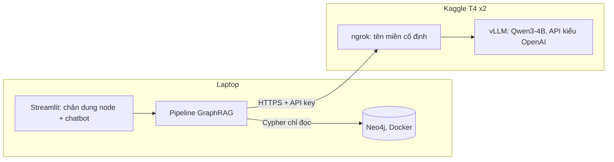
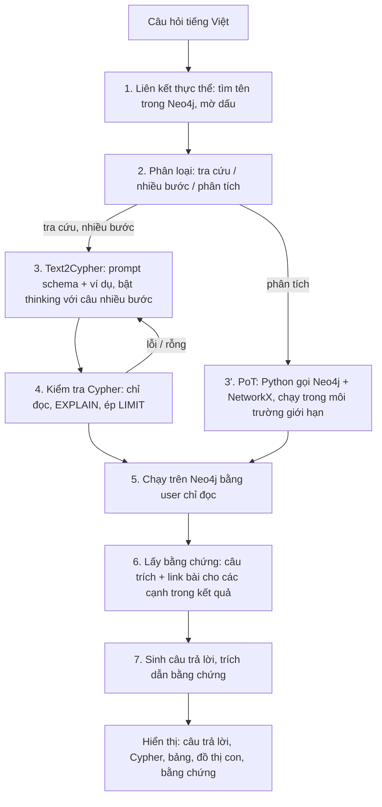

# Thiết kế chatbot GraphRAG: Qwen3-4B chạy trên Kaggle, ứng dụng chạy trên máy

## 1. Tổng quan

- **Kaggle** chỉ chạy mô hình (Qwen3-4B gốc, không cần train cho chatbot).
- **Laptop** chạy giao diện, pipeline và Neo4j (dữ liệu nằm sẵn trên máy).
- Ứng dụng chỉ biết một biến `LLM_BASE_URL`. Đổi sang Ollama (`http://localhost:11434/v1`) hoặc OpenRouter không phải sửa code.

## 2. Phía Kaggle: notebook phục vụ `player-graph-qwen3-4b-serve`

| Mục | Thiết lập |
|---|---|
| Accelerator | GPU T4 x2 |
| Internet | **Bật** (cần cho tunnel; tài khoản phải xác minh số điện thoại) |
| Input | Model `qwen-lm/qwen-3/transformers/4b/1`; dataset wheel vLLM nếu cần cài offline |
| Secrets (Add-ons → Secrets) | `NGROK_AUTHTOKEN`, `VLLM_API_KEY` (tự đặt, chuỗi ngẫu nhiên dài) |
| Thời gian | Đẩy bằng `kaggle kernels push -t <giây>`; ô cuối giữ phiên sống đến hết thời gian rồi tự tắt |

Các ô:
1. **Kiểm tra môi trường:** 2 GPU, phiên bản Python. vLLM 0.28 cần Python 3.12 (đã gặp lỗi `outlines_core` trên 3.13, xem `HANDOFF_VLLM.md`); nếu ảnh mặc định là 3.13 thì ghim môi trường cũ.
2. **Cài vLLM** từ wheel (hoặc pip khi có Internet), đặt `VLLM_USE_FLASHINFER_SAMPLER=0`.
3. **Khởi động vLLM** (dùng lại `VllmServer` trong `HANDOFF_VLLM.md`):
   `vllm serve <MODEL> --host 127.0.0.1 --port 8000 --api-key $VLLM_API_KEY --served-model-name qwen3-4b --tensor-parallel-size 2 --dtype half --max-model-len 16384 --gpu-memory-utilization 0.90 --reasoning-parser qwen3 --seed 0`
   Chờ `/health` (khoảng 4 phút).
4. **Mở tunnel ngrok** tới cổng 8000 với **tên miền tĩnh miễn phí** của tài khoản ngrok, nên địa chỉ không đổi giữa các lần chạy và không phải đọc log để lấy URL.
5. **Tự kiểm tra:** gọi `/v1/models` và một câu hỏi ngắn qua chính địa chỉ công khai, in kết quả.
6. **Giữ phiên:** vòng lặp in nhịp tim mỗi 5 phút đến khi hết `MAX_HOURS`, rồi tắt vLLM.

Vì sao chọn ngrok thay cho cloudflared: cloudflared không tài khoản chỉ cấp địa chỉ ngẫu nhiên mỗi lần chạy, mà log của phiên Kaggle chạy nền chỉ tải về được sau khi phiên kết thúc. Tên miền tĩnh của ngrok giải quyết việc này.

## 3. Phía máy: pipeline trả lời một câu hỏi

| Bước | Chi tiết |
|---|---|
| 1. Liên kết thực thể | Tìm tên người/CLB trong câu hỏi bằng so khớp mờ với `canonical_name` và `aliases` trong Neo4j, trước khi gọi mô hình. Đưa tên chuẩn vào prompt để mô hình không phải đoán cách viết ("MU" → "Manchester United") |
| 2. Phân loại | Một lời gọi ngắn, không thinking: `lookup` (1 bước), `multihop` (2–3 bước), `analytics` (thống kê, PageRank, cộng đồng) |
| 3. Text2Cypher | Prompt gồm schema (nhãn, 12 loại cạnh, cạnh suy diễn, thuộc tính), luật (luôn có `LIMIT`, dùng tên đã chuẩn hóa) và 15–20 ví dụ có số bước khác nhau. Câu nhiều bước bật `enable_thinking` (CoT) |
| 4. Kiểm tra | Chặn từ khóa ghi (`CREATE`, `MERGE`, `DELETE`, `SET`, `CALL dbms`...), chạy `EXPLAIN` để bắt lỗi cú pháp; lỗi hoặc kết quả rỗng thì gửi thông báo lỗi cho mô hình sửa, tối đa 2 lần |
| 5. Truy vấn | Tài khoản Neo4j riêng chỉ có quyền đọc; giới hạn thời gian truy vấn |
| 6. Bằng chứng | Với mỗi cạnh trong kết quả, lấy `ExtractionAssertion.evidence_text` và `SourceArticle.canonical_url` |
| 7. Trả lời | Prompt: chỉ dùng dữ liệu đã truy vấn, không bịa; nêu rõ khi không có dữ liệu; kèm số trích dẫn |

## 4. Giao diện (Streamlit)

- **Tab Hỏi đáp:** ô chat; dưới mỗi câu trả lời có thể mở xem Cypher, bảng kết quả, đồ thị con (pyvis) và danh sách bằng chứng có link.
- **Tab Chân dung node:** chọn người hoặc CLB → thẻ chỉ số (bậc, PageRank, betweenness, cộng đồng Leiden, hạt nhân k-core), đồ thị lân cận 1–2 bước, dòng thời gian sự kiện (chuyển nhượng, bổ nhiệm, sa thải, chỉ trích), đồng đội và HLV chính, câu hỏi gợi ý cho node đó.
- **Thanh bên:** trạng thái kết nối mô hình (xanh/đỏ), nút chuyển nguồn mô hình (Kaggle / Ollama / OpenRouter).

## 5. Đánh giá

- Bộ khoảng 100 câu hỏi **viết mới**, không trùng ví dụ trong prompt, có Cypher đáp án và chia theo 1/2/3 bước và nhóm phân tích.
- Độ đo: tỷ lệ Cypher chạy được, **execution accuracy** (kết quả trùng với Cypher đáp án), độ chính xác câu trả lời cuối, thời gian trả lời.
- So sánh: không thinking / có thinking (CoT) / PoT; Qwen3-4B so với một mô hình lớn (Gemini qua 9Router) làm mốc.
- Script đánh giá gọi cùng `LLM_BASE_URL`, chạy một lần khi phiên Kaggle đang bật.

## 6. Bảo mật và vận hành

- Không ghi khóa vào code hay GitHub: `NGROK_AUTHTOKEN`, `VLLM_API_KEY` để trong Kaggle Secrets; trên máy để trong `.env` (đã bị Git bỏ qua).
- Địa chỉ ngrok là công khai nên vLLM bắt buộc có `--api-key`.
- Kaggle dùng để thử nghiệm và chạy đánh giá; khi demo trước thầy nên có Ollama trên máy làm phương án dự phòng.

## 7. Thứ tự làm

1. Notebook phục vụ trên Kaggle, kiểm tra gọi được từ máy.
2. Module pipeline (`src/player_graph/chatbot/`): client LLM, liên kết thực thể, Text2Cypher, kiểm tra, truy vấn, bằng chứng, sinh câu trả lời.
3. Bộ câu hỏi đánh giá và script đo.
4. Giao diện Streamlit (hỏi đáp, chân dung node).
5. Thử nghiệm so sánh, đưa số liệu vào báo cáo.
